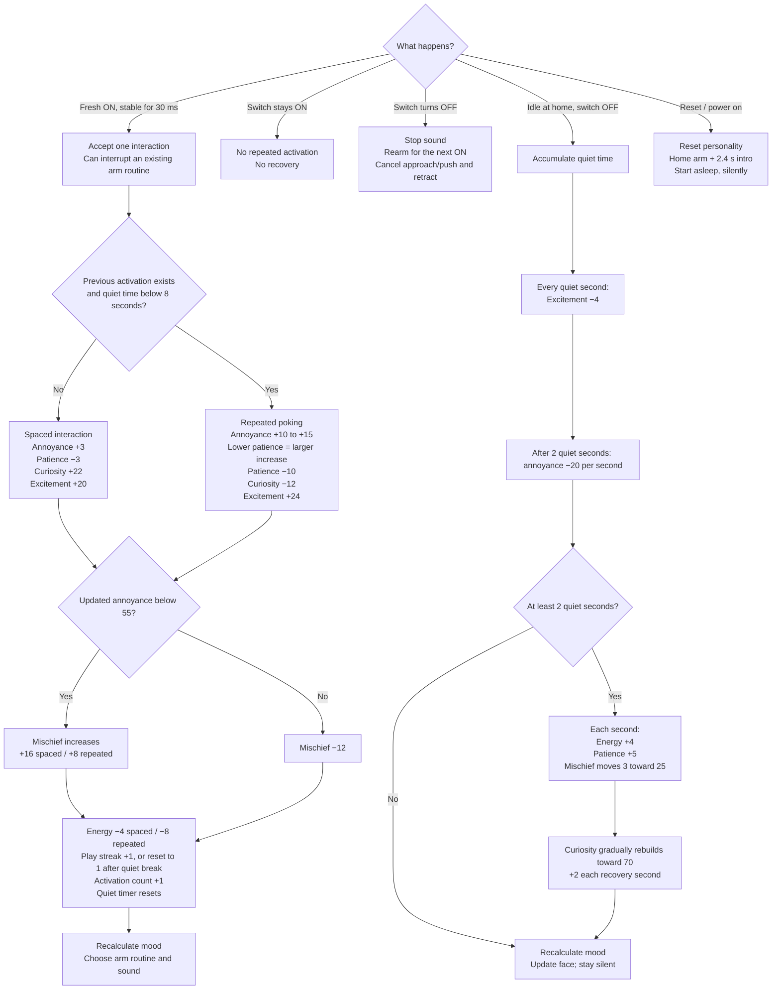
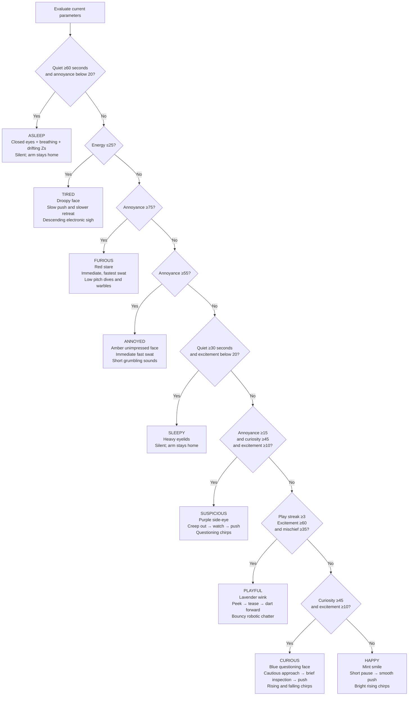
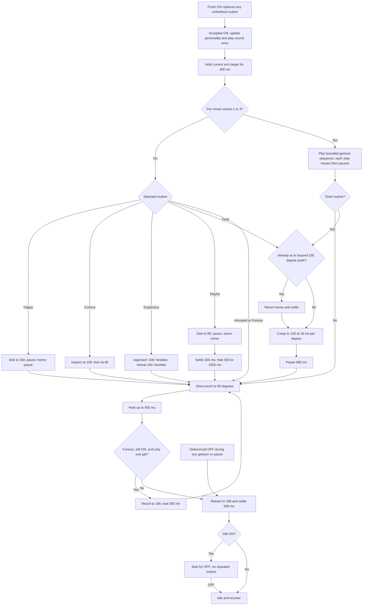

# Useless machine: personality and behavior flowchart

Updated for one arm servo and one switch on 2026-11-24. Moods are recalculated from the parameters, not selected from a fixed sequence. The machine can skip moods.

Source: `include/personality.h`, `include/interaction.h`, `src/main.cpp`, `src/face.cpp`, and `include/sound_patterns.h`.

## 1. Actions change its personality

All parameters stay between **0 and 100**. At startup: energy **90**, annoyance **0**, excitement **0**, curiosity **40**, patience **80**, mischief **25**.

For repeated poking, the exact annoyance increase is `10 + floor((100 − patience) / 20)`, using patience **before** that poke.

Quiet time starts only once the arm finishes returning and settling. Movement or a held-ON switch prevents recovery. Cancelling an interaction does **not** refund its parameter changes. A switch already ON at startup gets one attempt after startup settling.

Quiet time saturates at 300 seconds. Anger and other recovery begin at 2 seconds; the separate repeated-poking window remains 8 seconds. From total depletion, energy is full by 26 quiet seconds, and curiosity reaches 70 by 36 seconds. Curiosity above 70 is not reduced by recovery.

## 2. Parameters select the mood and response

Read from top to bottom. **The first matching condition wins.**

Sounds happen **only on an accepted activation**. Idle mood changes remain silent. When waking, the activation changes the parameters and resets quiet time **before** selecting the response; it therefore uses a new awake mood.

### Arm timings

| Mood | Routine |
|---|---|
| Happy | Bob out to 160°, hold 250 ms, home, hold 250 ms, swat |
| Curious | Inspect at 108°, creep to 90°, inspect 300 ms, slam |
| Suspicious | Approach 108°, hesitate, withdraw to 150°, wait 400 ms, lunge |
| Playful | Dart to 80°, pause, retract to 180°, settle, hide, slam |
| Annoyed | Immediate single swat |
| Furious | Swat, then only if still ON after 500 ms: recoil to 108°, wait 300 ms, second swat; stop after two |
| Tired | Creep at 18 ms/degree to 100°, wait 900 ms, direct slam to 60°, slow return |

Curious first approach/pause variants: 6/3/0 ms per degree and 120/240/350 ms. Suspicious: 8/5/10 ms per degree and 250/400/550 ms. Playful peek waits: 700/900/1100 ms; hidden waits: 650/850/1050 ms. Variant and routine are frozen per activation. Zero movement interval means a direct command, not instant physical arrival. All angles shown assume home 180° and push 60°.

## 3. Motion and interruption flow

The 30 ms debounce applies to every switch change. OFF cancels a pending fake-out or second jab. A fresh activation replaces old pending actions; it never queues an old surprise push. Quick repeats run the full selected variation after the sound lead-in, including tired creep/pause. A tired repeat starting at or beyond its peek resets home before approaching again. The furious second jab belongs to the same activation and is skipped as soon as OFF is detected.

## 4. Hardware and background activity

One servo only: D9 arm, D4 switch, D7 grid, D8 passive piezo. D11 is unused; there is no lid/pivot sequencing or clearance wait. The arm itself must clear the physical box throughout all gestures. Startup commands 180° during the 2.4-second silent face intro, then enables interactions. ON at boot gets one routine; OFF at boot remains asleep at rest.

The face keeps its mood transitions, blinking, breathing and a continuous stream of two 4×4 Zs. The letters move upward every 160 ms, staggered by five frames, and fully exit the top before restarting; rows 5–7 remain reserved for the face. Sound occurs only on accepted interactions; no sound on recovery/sleep or extra gesture stages. Timer1 drives one Servo object. LED transfers start at 4–14 ms of its 20 ms frame and require D9 LOW. The arm remains attached at home.

Sleepy/asleep motion profiles exist, but ordinary activation clears quiet time before routine selection, so their faces occur during rest while their motion profiles are normally unreachable. Tests cover active moods, cancellation, quick repeats including tired, bounded furious retries, startup, debounce and millis rollover.

Every accepted activation, including quick repeats, waits RESPONSE_PAUSE_MS = 400 ms after starting sound before dispatching its routine. OFF cancels this pending response and allows immediate retraction.

## 5. Three choreographies per active mood

Each routine keeps its own counter modulo three, advanced on accepted activation, starting with expressive variant 2 then rotating 3 → 1 → 2. Variant one follows the graph's original mood path; variants two and three follow a flash-stored sequence, then perform the direct push (or, for tired, continue through its slow 100° approach and 900 ms pause first). ResponsePause always happens first. Quick repeats no longer bypass theatre.

| Mood | Variant 2 | Variant 3 |
|---|---|---|
| Happy | Double greeting bob | Bow, wind back, swat |
| Curious | Double take with two retreats | Three-step approach, think, back up, inspect |
| Suspicious | Startle, fully hide, cautious return | Two aborted approaches, disappear, lunge |
| Playful | Double 80° fake-out and tiny peek | Long hide, two peeks, surprise attack |
| Annoyed | Two non-contact air-knocks | Freeze near switch, withdraw, swat |
| Furious | Wind-up shake | Charge, brake, recoil, attack |
| Tired | Nod off twice | Two droopy false starts |

ScriptMove advances nonblocking toward one target. ScriptPause waits its bounded duration before loading the next step. OFF cancels either state; fresh ON replaces the entire remaining sequence after a new 400 ms sound lead-in. Scripted gestures cannot trigger their own personality updates or sounds. Furious's second-jab rule and all rest endpoints remain unchanged.

## Mood progression tuning

Playful requires three pokes in a streak and excitement at least 60. A poke after eight quiet seconds starts a new streak at one; patience, curiosity, energy and anger still affect which mood wins. Spaced pokes cost 4 energy, repeated pokes cost 8. From startup with no recovery, playful first appears on poke three, annoyed on six, furious on seven/eight, and tired on nine. Tired takes priority over furious; fury remains possible when annoyance is high and energy sufficient. Maximum annoyance falls below the annoyed threshold after four idle/OFF seconds and clears after six. All cooldown starts after two quiet seconds. Movement or held ON prevents recovery.
