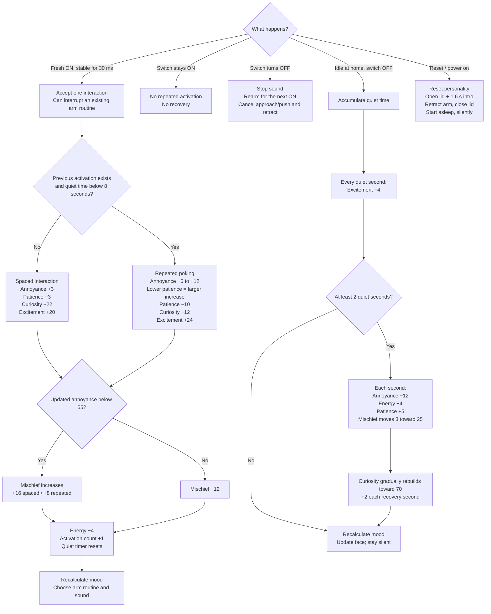
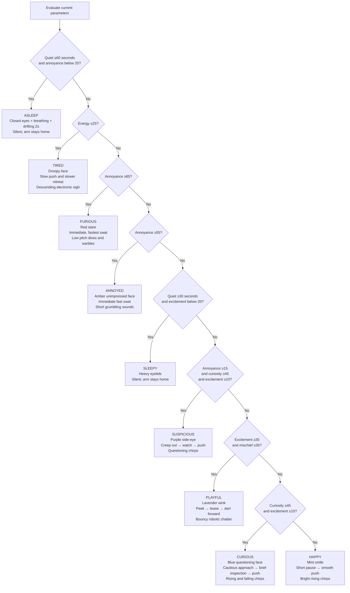
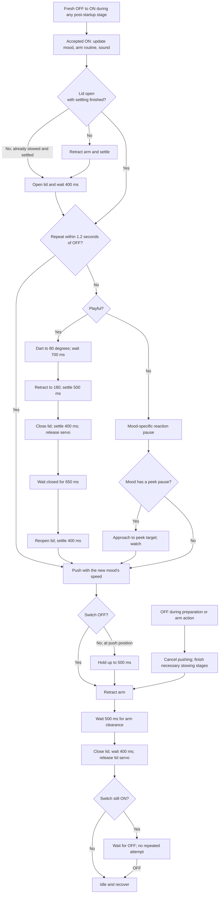

# Useless machine: personality and behavior flowchart

Updated for arm and lid servos with one switch on 2026-11-21. Moods are recalculated from the parameters, not selected from a fixed sequence. The machine can skip moods.

Source: `include/personality.h`, `include/interaction.h`, `src/main.cpp`, `src/face.cpp`, and `include/sound_patterns.h`.

## 1. Actions change its personality

All parameters stay between **0 and 100**. At startup: energy **90**, annoyance **0**, excitement **0**, curiosity **40**, patience **80**, mischief **25**.

For repeated poking, the exact annoyance increase is `6 + floor((100 − patience) / 16)`, using patience **before** that poke.

Quiet time starts only once the arm finishes returning and settling. Movement or a held-ON switch prevents recovery. Cancelling an interaction does **not** refund its parameter changes. A switch already ON at startup gets one attempt after startup settling.

Quiet time saturates at 300 seconds. Recovery begins at 2 seconds; the separate repeated-poking window remains 8 seconds. From total depletion, energy is full by 26 quiet seconds, and curiosity reaches 70 by 36 seconds. Curiosity above 70 is not reduced by recovery.

## 2. Parameters select the mood and response

Read from top to bottom. **The first matching condition wins.**

Sounds happen **only on an accepted activation**. Idle mood changes remain silent. When waking, the activation changes the parameters and resets quiet time **before** selecting the response; it therefore uses a new awake mood.

### Arm timings

| Mood | Initial pause | Approach to 60% travel | Pause there | Push | Return |
|---|---:|---:|---:|---|---|
| Happy | None | None | None | Direct target | Direct target |
| Curious | None | 6 ms/degree | 120 ms | Direct target | Direct target |
| Suspicious | None | 8 ms/degree | 250 ms | Direct target | Direct target |
| Playful / mischievous | None | Direct to 80° | 700 ms, then retract/close and wait 650 ms | Reopen, then direct target | Direct target |
| Annoyed / Furious | None | None | None | Direct target | Direct target |
| Tired | 100 ms | 18 ms/degree to 100° | 900 ms | Direct target | 7–8 ms/degree |

Direct targets request the servo's available speed, not instant physical arrival. Curious, suspicious and tired creep one degree at a time, pause, then command the push endpoint in one shot. The 500 ms push timeout and home settling delay remain. From fully stowed idle, opening starts immediately without another home wait. Other interrupted states still retract and settle first.

Ramped intervals use ARM_STEP_PERCENT = 10 with a 3 ms minimum. Energy adjustments apply before scaling. Playful uses a fixed 700 ms fake-out pause (including servo travel) and a 650 ms fully closed wait.

The behavior is selected once per activation. A new activation can replace it immediately. Home and push positions remain the calibrated endpoints; the normal peek position is `home + (push − home) × 60 / 100`, including for reversed mounting. Tired uses a separately configured 100° peek, then commands the 60° push target directly after 900 ms. OFF during the pause cancels the push.

## 3. Arm routine and interruptions

A fresh activation can interrupt a routine even outside the 1.2-second window; it then uses the normal mood-specific pauses. Immediate extension always requires lid clearance. A repeat during lid closing first retracts and settles, reopens the lid, and waits for clearance. A continuously held ON never creates another attempt. All switch changes must pass the 30 ms debounce.

### Face and sound coordination

- Face changes independently use **close eyes → blend expression and colors → reopen eyes**.
- Nine frames take about **320 ms**, extending when frames wait for safe sound/servo gaps.
- If another mood arrives mid-transition, the visible transition finishes before moving to the latest mood.
- Normal blinking resumes afterward; asleep has a gentle breathing effect and one complete 4×4 Z drifting above the face.
- Startup is a silent 1.6-second expanding/contracting blue light animation fading into the sleeping face. The personality starts asleep and wakes on an accepted ON.
- Sound starts only on accepted ON. OFF stops it after debouncing; idle recovery and startup are silent.
- Sound phrases use five short syllables, pitch updates every 4 ms, and silent gaps for LED updates.
- The two servos, switch input and audio player continue running without blocking animation delays.

### Currently unreachable motion profiles

Sleepy/asleep arm routines exist in the code (600 ms reaction, 45 ms/° approach and push, 350 ms peek, 55 ms/° return, plus the energy adjustment, then the same 10% movement scaling and one-third pause durations). Normal activation resets quiet time before choosing a routine, so those two motion profiles are currently unreachable. Their faces can still appear normally during quiet rest.

## Pin map and mechanical limits

D4 switch; D7 grid; D8 piezo; D9 arm; D11 lid. D5, D6 and D10 are unused. D4 is the only switch. Arm/lid angles and settling delays require mechanical calibration. The firmware knows commanded angles and elapsed time, not measured positions. LED transfers start at 6–14 ms of the two-servo frame and require both servo signals LOW.

The playful fake-out is part of one activation, not a repeated switch attempt. OFF cancels its pending slam, including during the closed wait and second opening. New activations replace the old routine; quick repeats bypass the fake-out. MISCHIEF_PEEK_DEG = 80, MISCHIEF_PEEK_PAUSE_MS = 700, MISCHIEF_CLOSED_WAIT_MS = 650.

### Expressive variants and gentler anger

The motion table shows the first variant. Subsequent accepted activations rotate through three variants: happy adds 0/100/200 ms inspecting pauses; curious approaches at 6/3/0 ms per degree (0 means direct) and waits 120/240/350 ms; suspicious approaches at 8/5/10 ms per degree and waits 250/400/550 ms. Playful keeps the same 80° fake-out but waits 700/900/1100 ms at the peek and 650/850/1050 ms closed. Tired and angry profiles retain their calibrated movements. Variants are frozen per activation, and quick repeats still skip pauses and fake-outs.

Without recovery, a fresh model reaches annoyed around poke eight and furious around poke ten. Five idle/OFF seconds reduce maximum annoyance below 55; ten clear it. No cooldown occurs during a held-ON switch or movement.
