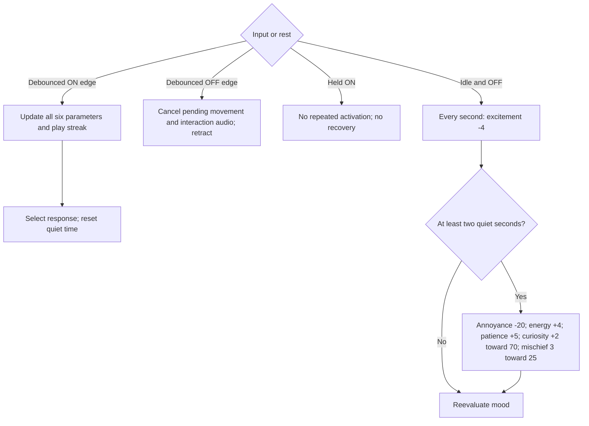
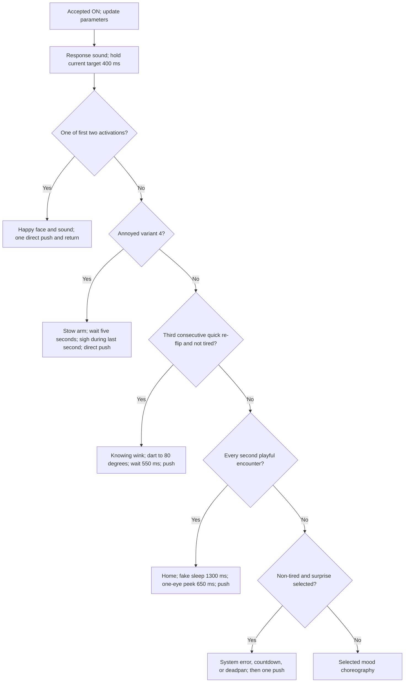
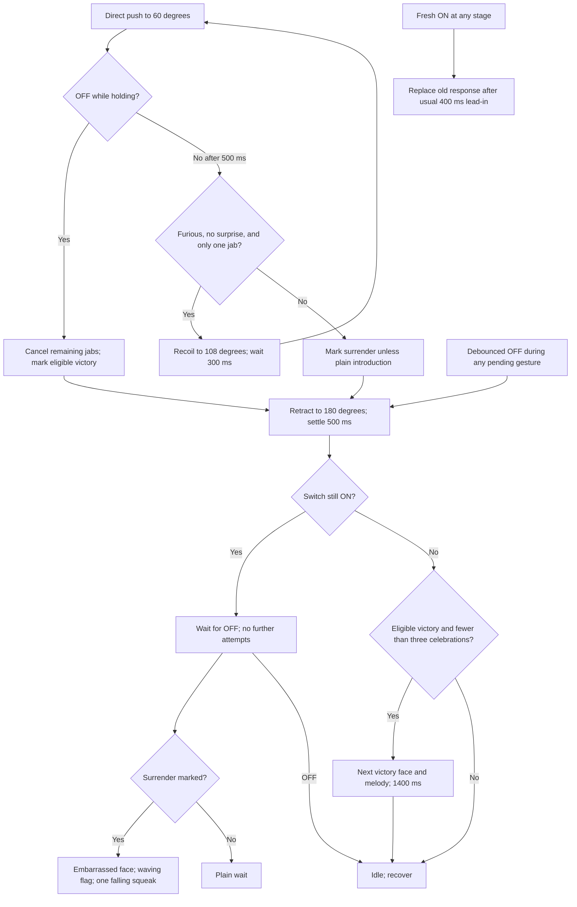

# Personality and behavior flowchart

This document describes the current implementation. The [README](../README.md) covers assembly, build commands, calibration, and tests; the [schematic](schematic.svg) records the described wiring.

## Parameters and recovery

All parameters are clamped to 0-100. A repeated poke means a previous activation exists and there have been fewer than eight seconds of quiet rest. It is separate from the 1.2-second quick re-flip window.

| Parameter | Initial value | Interaction | Quiet recovery per second |
|---|---|---|---|
| Energy | 90 | -4 spaced; -8 repeated | +4 |
| Annoyance | 0 | +3 spaced; +10 to +15 repeated, depending on patience | -20 |
| Excitement | 0 | +20 spaced; +24 repeated | -4 |
| Curiosity | 40 | +22 spaced; -12 repeated | +2 when below 70, capped at 70 |
| Patience | 80 | -3 spaced; -10 repeated | +5 |
| Mischief | 25 | +16 spaced or +8 repeated while annoyance is below 55; otherwise -12 | Moves 3 toward 25 |

Repeated annoyance gain is `10 + floor((100 - patience) / 20)`, evaluated before subtracting patience. Mischief uses annoyance after its increase. An activation increments the play streak up to three, or resets it to one after a quiet break, and resets quiet time. Cancelled activations retain their parameter changes.

Recovery runs only while idle at home with both raw and debounced switch states OFF. Excitement decays each quiet second; other recovery starts at two seconds. Moving or holding ON prevents recovery. Quiet time saturates at 300 seconds. Curiosity above 70 is not reduced by recovery. Dreams and victory celebrations do not prevent idle recovery.

## Mood priorities

The first matching condition wins. Mood is recalculated from parameters, so it can skip states.

| Priority | Mood | Condition |
|---|---|---|
| 1 | Asleep | Quiet at least 60 seconds and annoyance below 20 |
| 2 | Tired | Energy at most 25 |
| 3 | Furious | Annoyance at least 75 |
| 4 | Annoyed | Annoyance at least 55 |
| 5 | Sleepy | Quiet at least 30 seconds and excitement below 20 |
| 6 | Suspicious | Annoyance at least 15, curiosity at least 45, excitement at least 10 |
| 7 | Playful | Play streak at least 3, excitement at least 60, mischief at least 35 |
| 8 | Curious | Curiosity at least 45 and excitement at least 10 |
| 9 | Happy | Otherwise |

Activation updates parameters and clears quiet time before selecting a response. Sleepy/asleep therefore describe rest rather than ordinary activated routines. Startup sets quiet time to the asleep threshold. Parameters and counters reset on power-up; nothing is stored in EEPROM.

The first two accepted activations override movement, face, and sound with a plain happy response. The underlying model still advances; serial reports show that underlying mood. Sleepy/asleep rest expressions remain available during the introduction.

## Response selection and precedence

Every accepted activation starts its sound and holds the current arm target for 400 ms. The selection order after that pause is:

The introduction counts accepted activations, including ones cancelled before pushing. Held ON at startup consumes one activation after the 2.4-second intro. It does not consume mood variants, playful encounter counts, surprise selector calls, or victory celebrations. Sleep does not restart it.

Quick re-flips are ON within 1.2 seconds of OFF; a slower re-flip resets that streak. The quick streak includes introductory activations. Annoyed variant 4 overrides anticipation. Playful's encounter counter advances even when anticipation takes precedence.

## Mood choreography

All active moods have three variants except annoyed, which has four. Each has its own rotation, starting at variant 2: 2, 3, 1 for most moods, and 2, 3, 4, 1 for annoyed. Post-introduction activations advance the mood rotation even when an interaction trick replaces the chosen movement.

| Mood | Variant 1 | Variant 2 | Variant 3 |
|---|---|---|---|
| Happy | Bob to 160 degrees, wait 250 ms, home, wait 250 ms, push | Two greeting bobs | Bow, wind back, swat |
| Curious | Inspect at 108 degrees, closer look at 90, wait 300 ms, push | Double take with two retreats | Stepped approach and repeated inspection |
| Suspicious | Approach 108 degrees, withdraw to 150, wait 400 ms, lunge | Startle, hide, cautiously reappear | Two aborted approaches, hide, lunge |
| Playful | Dart to 80 degrees, pause, retract, settle, hide, slam | Two 80-degree fake-outs and a small peek | Long hide and two peeks |
| Annoyed | Single swat | Two air-knocks, then swat | Stare near switch, withdraw, swat |
| Furious | Swat, bounded second jab if still ON | Wind-up shake, attack | Charge, brake, recoil, attack |
| Tired | Slow approach, pause, slam, slow return | Two sleepy nods before slow approach | Droopy false starts before slow approach |

**Annoyed variant 4:** stow first if the arm is extended, then stay home for five seconds. At four seconds, close the eyes, open the mouth in a sigh, and play a descending exhale once. At five seconds, make one direct push with a deadpan face and retract. OFF cancels the wait, sigh, or push; a fresh ON replaces the routine. `ANNOYED_IGNORE_MS` controls the wait.

**Tired:** every variant ends with an 18 ms/degree creep to 100 degrees, a 900 ms pause, and a direct push to 60 degrees. Return is slow. If an activation starts at or beyond the peek angle, return home and settle before beginning the tired sequence.

Curious variant-1 approach timing varies with activation count: 6/3/0 ms per degree with 120/240/350 ms first pauses. Suspicious uses 8/5/10 ms and 250/400/550 ms. Playful's baseline peek lasts 700/900/1100 ms and its hidden wait 650/850/1050 ms. Scripted variants use their own flash-stored step timings.

All movement is nonblocking. A zero step interval sends the target directly; it does not mean the physical shaft arrives instantly. Gesture positions must clear the actual mechanism.

## Push result and interruption

Arm home is 180 degrees; push is 60 degrees. Each push holds for at most 500 ms. Retraction includes 500 ms settling.

OFF clears pending surrender and cancels remaining gestures. A routine cannot repeat just because ON is held. Furious allows two pushes; surprise performances allow only one even if the underlying mood is furious. Surrender occurs after attempts run out and the arm returns home, not during a playful fake-out. Introductory failures simply wait without surrender theatre.

Victories require an OFF edge during `Holding`, after the plain introduction. The controller cannot determine whether the arm or the user physically moved the switch. A fresh activation before retraction finishes cancels a pending celebration.

The first three completed victory celebrations per power-up are wink/confetti with ta-da, a pulsing heart with na-na boo-boo, and border confetti with a rising flourish. The arm stays home. A raw ON cuts off victory audio; the debounced ON replaces the performance.

## Surprise selector as implemented

The selector is called once per post-introduction activation. It excludes its first four calls, so a surprise cannot occur before activation seven. Eligible calls have a 1-in-12 chance. After a selection, eight intervening calls and at least 45 seconds must pass before another selection can succeed. Ineligible calls advance the counter but cannot select a performance. Consecutive selected surprises differ. Interaction timing perturbs the private pseudorandom generator.

This does not match the requested frequent-surprise setting (50% chance, no time cooldown, guaranteed after two eligible misses); that remains a firmware discrepancy.

| Performance | Visual and arm | Sound |
|---|---|---|
| System error | Home; colorful scanlines for 1.3 seconds, composed face, push at 1.8 seconds | Glitch chirp |
| Countdown | Home; 3, 2, 1 for 700 ms each, then push | Ticks at 0, 700, and 1400 ms |
| Deadpan | Home; flat eyes and mouth for 1.1 seconds, then push | Flat bloop |

These durations follow the normal 400 ms lead-in. They do not reset parameters or the controller. The plain introduction, annoyed sigh, anticipation, fake sleep, and tired routine take precedence.

## Face, dreams, and audio

Startup is a silent 2.4-second full-grid rainbow ignition/ripple animation fading into the live sleeping face and Zs. Nine mood expressions use blinking, breathing, and eye-close/blend/eye-open transitions. Two dim blue 4x4 Zs move upward every 160 ms; their color is independent of breathing.

After 12 seconds continuously asleep, a dim heart, star, or switch fades in and out over 3.2 seconds. Dreams repeat every 18 seconds and cycle pictures; normal Zs return between them. Sleep and dreams cause no sound or arm motion.

Mood phrases use 4 ms pitch updates. Special cues play for surprise performances, the annoyed sigh, surrender, and earned victories. OFF cancels response audio; victory audio is the deliberate exception while celebrating an OFF result. Startup, sleep, dreams, and ordinary idle recovery remain silent. `SOUND_ENABLED=false` mutes all audio.

Timer1 drives one Servo object. Arduino tone uses Timer2. LED transfers begin 4-14 ms into the servo's 20 ms frame while D9 is LOW and avoid active audible tones. The arm remains attached at home. Face animations may wait for audio rests before showing a frame.

## Hardware and verification

Signals: D4 switch, D9 arm, D7 grid, D8 piezo. The schematic shows a 330 ohm D4 pull-down, direct grid/piezo signal connections, and three parallel 470 uF / 16 V rail capacitors. Switch and piezo returns connect directly to Nano GND; grid and servo use the rails. See the README's unresolved switch-polarity note.

The test suite contains 103 controller scenarios plus separate audio timing checks and compile-time logic checks. It covers the introduction, active moods, special responses, successful and failed pushes, cancellation, rapid replacement, switch bounce, held-ON behavior, silent sleep, and timer rollover. Hardware torque, clearance, loudness, and LED readability require physical verification.
